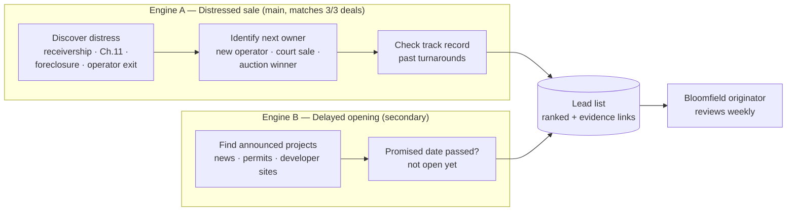

# Bloomfield Capital × UMich — Team 1: Distressed Deal Sourcing Agent

> **One line:** An AI agent that scans public data to find senior housing properties heading into distress — and the operators about to buy them — so Bloomfield Capital can offer a bridge loan **before a broker gets involved**.

**Status:** Final (Nov 11, 2026): the Deal Radar website is live (private, password-protected) · next steps in [`docs/ROADMAP.md`](docs/ROADMAP.md)
**Last updated:** Nov 11, 2026

## Final state (Nov 11, 2026)

**Deal Radar** is a password-protected website on Render (service `deal-radar-umich`, branch `development`). It shows a
**static snapshot** of the public lead list: no database connection and no key at runtime.

**Map-first:** the home page is a US map with three headline numbers and List A / B / C toggles. Click a state, then a
city bubble, then a property pin to open the lead card (rank, score, stage, buyer, signals with source links, and the
building's public phone / website). Search and the breadcrumb are always visible; Esc or Back goes up one level. The
top bar also has **Leads** (the ranked list), **Buyers** (Named · Candidate · not final · Unverified · List C repeat
buyers), **The numbers** (reconciliation and funnel), **Watch list** and **How it works** (the `?` button).

| Final number (published snapshot, Nov 11, 2026) | Value |
|---|---|
| Public leads (main list) | **485** = List A 206 + List B 228 + 51 other |
| Other (neither A nor B) | 18 stalking-horse candidates · 24 older ownership changes · 3 sales under way with no public buyer · 5 sales approved or closed with no public buyer · 1 shell / closed |
| List C: repeat buyers | 159 companies, linked to 35 of the leads |
| States covered | 44 |
| Leads with a named buyer | 43% (207) |
| Leads with a public phone or website | 45% (217) |
| AL / IL / MC / CCRC share | 13% of the main list · 35% of the top 20 · 42% of the top 50 |
| Watch list (Explore) | 7,255 buildings |
| Stage "Sale approved" / "Closed / sold" | 22 / 186 (176 of the closed ones come from one portfolio sale and are flagged `portfolio_sale_inferred`) |
| Tests | 295 passing (`pytest -q`) |

Every buyer and signal on the site rests on a public source link; missing values read `NOT FOUND`. Licensed facts are
never shown or scored in the public view.

**Nov 11 human review of the top 20:** stages now read "Sale approved (date)" or "Closed / sold (date)" and closed
sales rank below live ones; buyers were corrected from court filings (`config/manual_overrides.yaml`, each with a
public link and a date); a parent company's bankruptcy is no longer attached to a home that changed hands before the
petition date (533 → 485 leads); source links are listed best page first. Still open: the roundup rule for buyers and
closing notices for approved sales ([roadmap](docs/ROADMAP.md) items 11 and 12).

### Refresh and publish the site

Run on a team laptop with the pipeline set up (`.env` has the database URL and `RENDER_API_KEY`):

1. Refresh the data: the pipeline commands in [section 12](#12-repo-structure) (collect → extract → enrich →
   `python -m src.score` → `python -m src.score.takeovers`).
2. `.venv/bin/pytest -q` and the full leak check (`python tools/leak_guard.py --range origin/development...HEAD` for
   code; the publish command checks the data).
3. **Dry run:** `python -m src.web.publish`. It rebuilds the snapshot, packs it (must stay under 900 KB), runs the leak
   checks (private terms, `licensed:` tags, past-deal homes, the client's name outside place names, funnel totals) and
   prints the Render calls it *would* make. Nothing changes on Render.
4. **Publish:** `python -m src.web.publish --confirm`. It keeps the previous upload as
   `output/site_snapshot.prev.b64`, uploads `output/site_snapshot.b64` as the Render Secret File, starts a deploy, waits
   until it is live and checks `/healthz` = 200. If anything fails it stops; do not retry blindly, read the output.
5. Open the site, log in, and click home → a state → a city → a lead card.

`output/` is gitignored: never commit the snapshot (`git add -f` is forbidden). Render `autoDeploy` is off, so merging
a pull request does **not** update the site; a code change also needs a deploy (step 4, or *Manual Deploy* in the
Render dashboard).

### Roll back

- **Data (the snapshot):** in the Render dashboard → service → *Environment* → *Secret Files*, replace the contents of
  `site_snapshot.b64` with the contents of `output/site_snapshot.prev.b64`, save, then *Manual Deploy → Deploy latest
  commit*. Check `/healthz` = 200 and the snapshot date on the site. Then copy `prev.b64` over
  `output/site_snapshot.uploaded.b64` so the next publish keeps the right rollback copy.
- **Code:** revert the pull request on `development` (GitHub *Revert* button → merge), then *Manual Deploy*; or in the
  Render dashboard pick the previous deploy under *Events* and choose *Rollback* (this restores the code build; the
  Secret File stays as it is).
- An encrypted copy of the final snapshot and submission exports is kept off-repo (macOS Keychain item
  `deal-radar-backup` holds its password).

See [`HANDOFF.md`](HANDOFF.md) for the hand-over checklist and [`docs/ROADMAP.md`](docs/ROADMAP.md) for what comes next.

---

---

## Table of Contents
1. [Background](#1-background)
2. [The Problem](#2-the-problem)
3. [Scope](#3-scope-confirmed-with-bloomfield-on-nov-4-2026)
4. [Key Insight: Who the Real Customer Is](#4-key-insight-who-the-real-customer-is)
5. [Our Approach](#5-our-approach)
6. [Distress Signals & Metrics](#6-distress-signals--metrics)
7. [Data Sources](#7-data-sources)
8. [Build Map](#8-build-map)
9. [Requirements](#9-requirements)
10. [Success Metrics](#10-success-metrics)
11. [Roadmap](#11-roadmap)
12. [Repo Structure](#12-repo-structure)
13. [Open Questions](#13-open-questions)
14. [Risks](#14-risks)
15. [Glossary](#15-glossary)
16. [References](#16-references)

---

## 1. Background

**Bloomfield Capital** is a commercial real estate lender (~20 people, ~$500M fund from ~70 institutional investors, mostly pension funds).

| | |
|---|---|
| **Main product** | **Bridge loans**: short-term (~2 yr), ~12% + points, on properties that banks won't lend on yet |
| **Typical deal** | $10–30M (public range $3–30M) |
| **Focus assets** | Senior housing (independent living, assisted living, memory care, skilled nursing) and hotels |
| **Edge** | Speed and certainty: no appraisal required, small team, quick decisions |
| **Avoids** | Office (most office bridge requests are rejected) |

> **Analogy:** a bridge loan is a cast on a broken leg. It holds the property up until it heals, and then a cheaper bank loan replaces it.

## 2. The Problem

- ~**100 deal emails/week** come in, almost all from **brokers** → ~20 conversations → ~5 term sheets → ~**1 closes**.
- Once a broker is involved, the broker shops the deal to many lenders, so Bloomfield competes on price.
- **Goal (per Bloomfield):** grow deal flow from **~$200M/yr to ~$300M/yr** without hiring more people by finding **proprietary deal flow**, i.e., deals sourced directly rather than through brokers.

**Our prompt (Team 1):** Use AI to find distressed properties and their owners/buyers **before a broker does**.
*(Team 2 works on screening/filtering incoming deals — not us.)*

## 3. Scope (confirmed with Bloomfield on Nov 4, 2026)

| ✅ In scope | ❌ Out of scope |
|---|---|
| **Sourcing** (top of the funnel) | Screening/underwriting (Bloomfield has its own agent; that's Team 2's area) |
| **Bridge loan originations** | Buying distressed notes |
| **Senior housing** first (nationwide; can narrow by state) | Office |
| **Start wide**: 100 leads = good, 1,000 = amazing | Rebuilding commercial CMBS loan databases (anyone can buy them, so they aren't unique) |
| **Creative web crawling / AI agents** on public data | Private or confidential data we can't legally access |

> Bloomfield project lead: *"Be creative about coming up with a way to find proprietary deal flow."*

## 4. Key Insight: Who the Real Customer Is

Bloomfield shared 3 recent senior housing bridge loans (details are confidential and **not stored in this repo**). In **all three**:

1. The property **failed first** (receivership, Chapter 11, or the lender taking it back after a default).
2. A **new operator** with a track record **bought it cheap**.
3. **Bloomfield lent to the buyer** to fund the turnaround.

**→ Bloomfield's borrower is the *buyer/new operator*, not the distressed owner.**
So our tool must find **(a) the distressed property** *and* **(b) who is taking it over**.

> **Analogy:** the failing restaurant isn't the customer. The chef buying the space to reopen it is.

What makes a distressed deal **lendable** (Bloomfield's "common thread"):
- Loan amount **below what a stabilized buyer would pay**
- An **operator with evidence of execution** (ideally in the same market)
- A **defined exit** (e.g., a HUD or bank refinance can pay off the bridge loan)

## 5. Our Approach

### Two lead engines



### Distress timeline (catch it as early as possible)

```
EARLY (weak)             → MIDDLE (loan stress)     → LATE (legal process)      → SALE (the lead)
low occupancy, losses,     DSCR < 1.0, missed         receivership, Ch.11,        new operator /
delayed opening,           payments, loan maturing,   foreclosure,                buyer appears
operator turnover, liens   special servicing          deed-in-lieu
```

### Positioning vs. what already exists

| Existing | What it does | Our add |
|---|---|---|
| **Bloomfield's existing Distressed Feed** | Google News search for "Chapter 11" + senior living/SNF, scored, logged to a Google Sheet | Receiverships, lender takebacks, delayed openings, **buyer identification**, filled-in location and unit counts |
| **Commercial CMBS loan databases** | DSCR/special servicing for securitized (CMBS) loans | Covers what they miss: non-securitized loans, private owners, assisted living |
| **Circlemark, Reonomy, ATTOM** | General CRE ownership and distress data for brokers | **Senior-housing-specific** signals + Bloomfield's lending criteria |

## 6. Distress Signals & Metrics

Based on Bloomfield's examples and the 3 past deals.

| # | Signal | What to look for | Stage |
|---|---|---|---|
| 1 | **DSCR** (NOI ÷ debt service) | **< 1.0x** = can't cover payments | Middle |
| 2 | **Loan maturing + low DSCR** | Matures within ~12 mo **and** DSCR < 1.2x | Middle |
| 3 | **Delayed opening** | Promised open date passed, not open | Early |
| 4 | **Mechanics liens** | Any contractor lien filed | Early |
| 5 | **Bankruptcy** | Chapter 11 by owner/operator | Late |
| 6 | **Receivership / deed-in-lieu** | Court-appointed receiver; lender takeback | Late |
| 7 | **Operator turnover** | 2+ operators in a few years; "new management" | Early–Late |
| 8 | **Low occupancy** | well below the market average (threshold in `config/thresholds.yaml`) | Early |
| 9 | **Negative NOI / losses** | Operating at a loss | Early–Middle |
| 10 | **Price collapse** | Sale $/unit far below prior loan $/unit | Sale |

**Fundability flags** (light, since screening is Bloomfield's job): operator track record · purchase price vs. prior basis · exit path.

> ⚠️ Thresholds for #7–#10 are our assumptions — to confirm with Bloomfield.

## 7. Data Sources

| Signal(s) | Source | Cost | Notes |
|---|---|---|---|
| 1, 2 | **Licensed loan data** (kept out of the repo) | Licensed | Facts stay in `eval/private/` and schema `private`; never in public output |
| 1, 2 | [Fannie Mae Multifamily Loan Performance Data](https://capitalmarkets.fanniemae.com/credit-risk-transfer/multifamily-credit-risk-transfer/multifamily-loan-performance-data) / DUS Disclose | Free | Agency loans incl. seniors housing |
| 3 | Local news, developer sites, city permits / certificates of occupancy | Free | Engine B |
| 4, 6, 10 | County register of deeds | Free | Liens, deeds-in-lieu, sale prices; varies by county |
| 5, 9 | [CourtListener / RECAP](https://wiki.free.law/c/courtlistener/help/data-coverage/federal-cases-and-filings) (API), PACER | Free / ~$0.10/pg | Federal bankruptcy dockets |
| 6 | State court portals | Free | Receiverships, not centralized |
| 7 | [CMS SNF Change of Ownership](https://catalog.data.gov/dataset/skilled-nursing-facility-change-of-ownership) | Free | Nursing homes only |
| 7 | State licensing, e.g., [Michigan LARA statewide HFA/AFC file](https://www.michigan.gov/lara/bureau-list/bchs/adult/online-lookups/statewide-text-file-of-adult-foster-care-homes-for-the-aged-facilities) | Free | Assisted living ("homes for the aged" in MI) |
| 8 | [CMS Nursing Home Provider Information](https://catalog.data.gov/dataset/provider-information) | Free | Residents/day ÷ certified beds ≈ occupancy |
| 9 | [CMS Payroll Based Journal staffing](https://catalog.data.gov/dataset/payroll-based-journal-daily-nurse-staffing) | Free | Labor-cost red flags |
| 8 | NIC MAP, CoStar | Paid | Ask Bloomfield to run queries |
| 5–7 | Senior Housing News, Skilled Nursing News, McKnight's, Google News RSS | Free / partial | Main text input for the AI |

**Start with (80/20):** trade press + CourtListener + CMS ownership data → add licensed loan data where available → county records as a 1–2 county pilot.

## 8. Build Map

| Section | Our answer |
|---|---|
| **Input** | Search target: senior housing + distress types + region |
| **Data** | Public web: news, court dockets, CMS datasets, state licensing, county records. Test set: Bloomfield's past deals (confidential, kept outside the repo) |
| **AI Step** | **Extract.** From each notice/article, pull: property, city/state, units, distress type, stage, receiver/debtor, **buyer/new operator**, key dates |
| **Logic** (code, not the model) | Stage rules (filed → sale pending → sold), months since event, de-duplication (name + city), drop office, scoring |
| **Output** | Ranked lead table: property, location, units, distress type, stage, likely buyer, score, **source links** |
| **Human Check** | Bloomfield originations analyst reviews top leads weekly before any outreach |
| **Must Never** | Never list a lead without a source link proving the distress signal |
| **When Unsure** | Write `NOT FOUND`, leave the score blank, flag the row for review. Never guess |

## 9. Requirements

1. **Main job:** When the analyst gives the tool distress notices/articles about senior housing, it extracts property, location, units, distress type, stage, and buyer/operator, so that leads are found before brokers. **Done when 18 of 20 test articles are extracted correctly.**
2. When a property shows a late-stage signal (receivership, Ch.11, foreclosure), the tool marks the stage and ranks it, **so the most actionable leads are on top**. **Done when all test cases are staged correctly.**
3. When a field isn't in the source, the tool writes `NOT FOUND` and flags the row. **Done when every missing field in the test set shows NOT FOUND.**
4. Every lead includes its source link. **Done when 100% of rows have a working link.**
5. **Backtest:** Given only public sources, the tool would have surfaced Bloomfield's 3 past deals. **Done when it catches all 3.**

## 10. Success Metrics

| Metric | Target |
|---|---|
| **Lead volume** | 100+ (stretch: 1,000) |
| **Recall on past deals** | 3 / 3 |
| **Lead quality** | Bloomfield reviews 20 leads → share they'd actually call |
| **Coverage** | % of leads with buyer/operator identified |
| Baseline to beat (long term) | ~1 closed deal per 100 reviewed |

## 11. Roadmap

| Phase | Work | Done when |
|---|---|---|
| **0. Ground truth** | Map the 3 past deals to their public signals; get Bloomfield's existing feed sheet | Each deal has its trigger + public source |
| **1. Discover** | Crawl trade press, CourtListener, CMS CHOW for senior housing distress | 200+ raw notices |
| **2. Extract** | Claude extracts structured fields per notice | Requirement #1 passes |
| **3. Enrich** | Buyer/operator ID, track record, location/units | Most leads have an operator |
| **4. Score + output** | Staging, de-duplication, ranking → sheet/dashboard | Ranked list of 100+ |
| **5. Backtest + demo** | Requirement #5; present to Bloomfield | Demo + results |
| *Stretch* | Engine B (delayed openings), DSCR screen on licensed loan data, weekly email digest | — |

**Status (Nov 11, 2026):** phases 1–5 are done and the site is live (see [Final state](#final-state-nov-11-2026)).
Next steps are in [`docs/ROADMAP.md`](docs/ROADMAP.md).

## 12. Repo Structure

**Stack:** Supabase (Postgres) for all data · Python 3.11 loaders built by Claude Code subagents in waves (see `docs/EXECUTION_PLAYBOOK.md`) · the website (`src/web/`) is a password-protected static snapshot of the public view of ranked leads, served on Render.

**Data model: two hubs.** Every source attaches to one of two hubs, never to each other:
- **Hub 1, `core.facility`:** the building. Matched exactly on CMS CCN or license number, otherwise fuzzily on name + address (address counts more, because facilities get renamed after a sale).
- **Hub 2, `core.organization`:** the buyer, owner or operator, linked to facilities through roles and ownership events.
- Data flows `raw` (untouched downloads) → `stg` (one typed table per source) → `core` (one row per real thing) → `app` (the ranked lead list). Only the `app.v_lead_list` view is readable with the public key.

```
.
├── README.md
├── docs/                    # BUILD_SPEC (source of truth), EXECUTION_PLAYBOOK, PIPELINE_RULES, schema_requests
├── config/thresholds.yaml   # every signal/score threshold, labeled as assumptions
├── supabase/migrations/     # database schema (orchestrator only)
├── data/raw/                # download cache (gitignored)
├── src/
│   ├── common/              # shared: polite HTTP client, raw writer, ingest log, DB, normalizers
│   ├── discover/            # loaders: CMS, HUD, courts, news, state licensing
│   ├── extract/             # Claude extraction prompts + schema
│   ├── enrich/              # facility/organization matching (the two hubs)
│   ├── score/               # signals, buyer linking, scoring
│   ├── web/                 # Deal Radar site: snapshot builder, publish command, server, static map UI
│   └── App.jsx, lib/, data/ # older Vite starter page (not the Deal Radar site)
├── tests/                   # pytest
├── eval/                    # test articles, reports, backtest (eval/private/ is gitignored)
└── output/                  # lead list CSVs
```

**Run it:** `python3.11 -m venv .venv && .venv/bin/pip install -r requirements.txt`, copy `.env.example` to `.env` and fill it in, then `.venv/bin/pytest -q`.

**Pipeline commands (in order):**
| Step | Command |
|---|---|
| Collect | `python -m src.discover.<source>` (cms, hud, courts, news, licenses); public court filings our searches miss: `python -m src.discover.courts --source court_manual` (from `config/court_facts.yaml`) |
| Split roundup articles | `python -m src.extract.split` (one item per deal in "dealbook" articles) |
| Read articles with AI | `python -m src.extract` (Claude Sonnet; `LLM_PROVIDER` in `.env` selects the provider, and a new model must pass `python -m eval.extraction.compare_models` before it is used for production) |
| Match to buildings / companies | `python -m src.enrich` |
| Score + lists | `python -m src.score`, then `python -m src.score.takeovers` |
| Demo exports | `python -m src.score.final_exports` → `output/list_A_live_deals.csv`, `list_B_presale_distress.csv`, `list_C_repeat_buyers.csv`, `top_20_for_handcheck.csv` |
| Website | `python -m src.web.publish` (dry run), then `python -m src.web.publish --confirm` (upload + deploy); see [Final state](#final-state-nov-11-2026) |

Bloomfield-facing outputs use the public view only; licensed facts stay in the private schema and in `INTERNAL_*` files.

> 🔒 **Do not commit** Bloomfield's deal details, emails, or anything marked confidential. Keep `.env` and API keys out of git.

## 13. Open Questions

- [ ] Can we get Bloomfield's existing Distressed Feed Google Sheet?
- [ ] Preferred states/metros, if any?
- [ ] Occupancy/NOI thresholds that make Bloomfield interested?
- [ ] Final deliverable format and demo date (confirm with program coordinator)

## 14. Risks

| Risk | Mitigation |
|---|---|
| Receivership filings are spread across state courts | Start with news + 2–3 states |
| Buyer is unknown until late in a sale | Also list the receiver/trustee as a contact |
| CMS data covers nursing homes only | State licensing + news for assisted living |
| Overlap with Bloomfield's existing feed | Position as an extension: receiverships + buyer ID |
| AI false positives | Source link required on every row; spot-check 20 by hand |

## 15. Glossary

| Term | Meaning | Analogy |
|---|---|---|
| **Bridge loan** | Short-term loan from unstable → stable | A cast until the leg heals |
| **NOI** | Revenue − operating expenses | Take-home pay before rent |
| **DSCR** | NOI ÷ annual debt payments; lenders want ~1.25x | Earning $1.25 for every $1 you owe |
| **Debt yield** | NOI ÷ loan amount | Lender's return if they owned the building |
| **CMBS** | Commercial loans pooled and sold as bonds | *The Big Short*, for commercial buildings |
| **Special servicing** | Troubled CMBS loan handed to a workout specialist | Patient moved to the ICU |
| **Receivership** | Court-appointed manager runs the property | A substitute teacher put in by the principal |
| **Deed-in-lieu** | Owner hands the property back to the lender | Returning the car keys before repossession |
| **Mechanics lien** | Contractor's public claim for unpaid work | An unpaid plumber's IOU on your door |
| **IL / AL / MC / SNF** | Independent living / assisted living / memory care / skilled nursing | — |
| **CCRC** | Campus with all levels of senior care | — |

## 16. References

- Kickoff session recording (Oct 27, 2026) and Team 1 × Bloomfield meeting (Nov 4, 2026) — notes in `docs/`
- [Fannie Mae Multifamily Loan Performance Data](https://capitalmarkets.fanniemae.com/credit-risk-transfer/multifamily-credit-risk-transfer/multifamily-loan-performance-data)
- [CourtListener federal case coverage](https://wiki.free.law/c/courtlistener/help/data-coverage/federal-cases-and-filings)
- [CMS SNF Change of Ownership](https://catalog.data.gov/dataset/skilled-nursing-facility-change-of-ownership)
- [CMS Nursing Home Provider Information](https://catalog.data.gov/dataset/provider-information)
- [Michigan LARA statewide HFA/AFC facility file](https://www.michigan.gov/lara/bureau-list/bchs/adult/online-lookups/statewide-text-file-of-adult-foster-care-homes-for-the-aged-facilities)
- [Bloomfield Capital bridge loan example (GlobeNewswire, 2023)](https://www.globenewswire.com/news-release/2023/01/18/2591254/0/en/Direct-Lender-Funds-Loan-on-Hotel-in-Pennsylvania-4-0-Million-Senior-Bridge-Loan.html)
